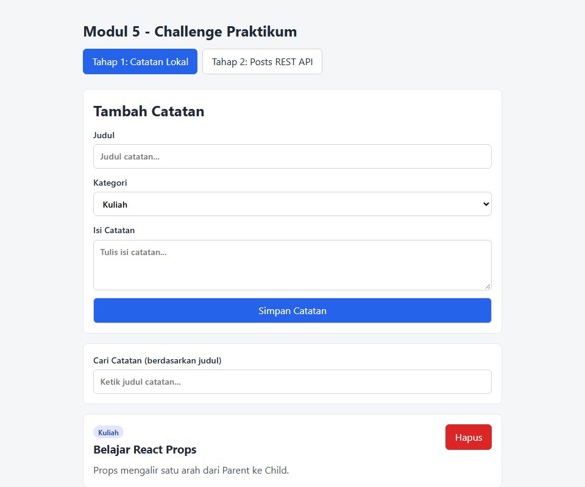
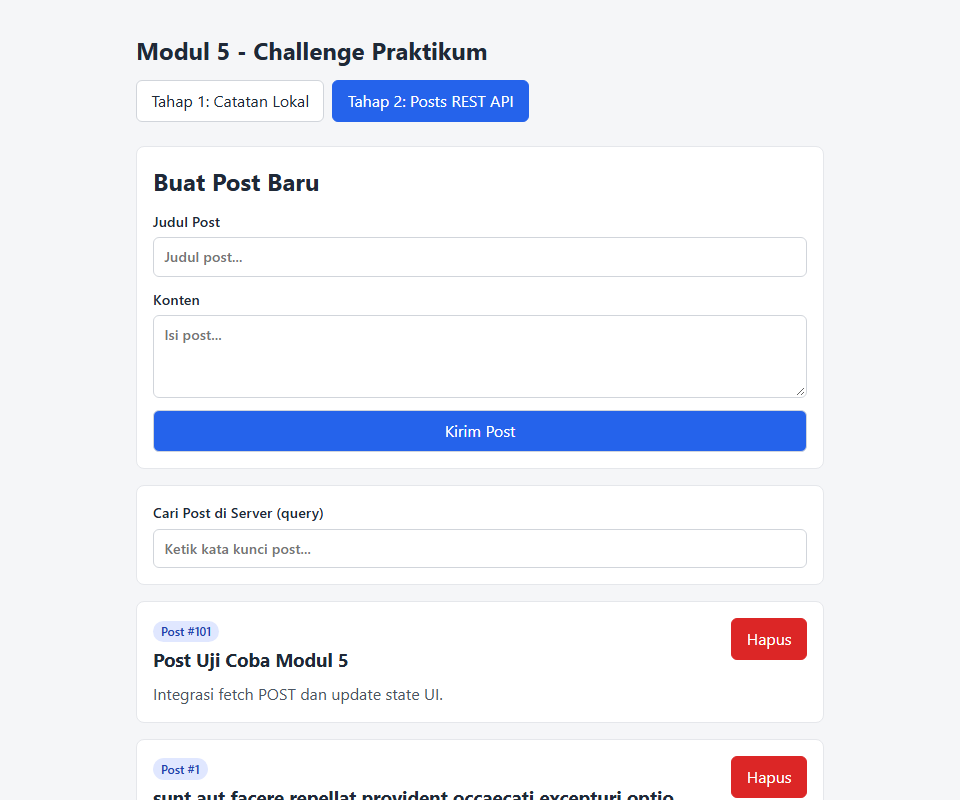

# Complete Guide: Modul 5 Challenge (React + TypeScript)

| | |
|---|---|
| **Tipe** | Proyek (berbasis file) |
| **Subjek** | `D:\ITS College Docs\30 - 3rd Semester\Web Programming\Praktikum-5\Challenge` |
| **Dibuat** | 2026-11-16 16:08 |
| **Terakhir diperbarui** | 2026-11-16 16:19 |
| **Cakupan** | 21 file proyek, 24 blok kode, 1 perintah build, 0 aksi GUI, 2 tangkapan layar |
| **Dikecualikan** | `node_modules/` (dependensi), `package-lock.json` (lockfile otomatis), `dist/` (hasil build Vite) |

## Daftar Isi

- [1. Gambaran Umum](#1-gambaran-umum)
  - [1.1 Apa proyek ini](#11-apa-proyek-ini)
  - [1.2 Tujuan pembuatan](#12-tujuan-pembuatan)
  - [1.3 Cara tiap bagian terhubung](#13-cara-tiap-bagian-terhubung)
  - [1.4 Lingkungan dan prasyarat](#14-lingkungan-dan-prasyarat)
  - [1.5 Istilah penting](#15-istilah-penting)
- [2. Struktur File](#2-struktur-file)
  - [2.1 Peta file](#21-peta-file)
  - [2.2 Urutan membaca kode](#22-urutan-membaca-kode)
- [3. Bedah Kode dan Konfigurasi](#3-bedah-kode-dan-konfigurasi)
  - [3.1 File: `index.html`](#31-file-indexhtml)
  - [3.2 File: `src/main.tsx`](#32-file-srcmaintsx)
  - [3.3 File: `src/types/note.ts`](#33-file-srctypesnotets)
  - [3.4 File: `src/types/post.ts`](#34-file-srctypespostts)
  - [3.5 File: `src/hooks/useLocalStorage.ts`](#35-file-srchooksuselocalstoragets)
  - [3.6 File: `src/services/postService.ts`](#36-file-srcservicespostservicets)
  - [3.7 File: `src/components/NoteForm.tsx`](#37-file-srccomponentsnoteformtsx)
  - [3.8 File: `src/components/NoteCard.tsx`](#38-file-srccomponentsnotecardtsx)
  - [3.9 File: `src/components/PostForm.tsx`](#39-file-srccomponentspostformtsx)
  - [3.10 File: `src/components/PostCard.tsx`](#310-file-srccomponentspostcardtsx)
  - [3.11 File: `src/App.tsx`](#311-file-srcapptsx)
  - [3.12 File: `src/index.css`](#312-file-srcindexcss)
  - [3.13 File: `package.json`](#313-file-packagejson)
  - [3.14 File: `vite.config.ts`](#314-file-viteconfigts)
  - [3.15 File: `tsconfig.json`](#315-file-tsconfigjson)
  - [3.16 File: `tsconfig.app.json`](#316-file-tsconfigappjson)
  - [3.17 File: `tsconfig.node.json`](#317-file-tsconfignodejson)
  - [3.18 File: `.oxlintrc.json`](#318-file-oxlintrcjson)
  - [3.19 File: `.gitignore`](#319-file-gitignore)
  - [3.20 File: `README.md`](#320-file-readmemd)
  - [3.21 File: `public/favicon.svg`](#321-file-publicfaviconsvg)
  - [3.22 Command: `npm.cmd run lint` dan `npm.cmd run build`](#322-command-npmcmd-run-lint-dan-npmcmd-run-build)
- [4. Alur Kerja End-to-End](#4-alur-kerja-end-to-end)
  - [Skenario A: Tambah, filter, dan simpan catatan (Tahap 1)](#skenario-a-tambah-filter-dan-simpan-catatan-tahap-1)
  - [Skenario B: Ambil, tambah, cari, dan hapus post API (Tahap 2)](#skenario-b-ambil-tambah-cari-dan-hapus-post-api-tahap-2)
- [5. Catatan Penting dan Potensi Masalah](#5-catatan-penting-dan-potensi-masalah)
- [Riwayat Revisi](#riwayat-revisi)

## 1. Gambaran Umum

### 1.1 Apa proyek ini

Aplikasi Single-Page Application (SPA) menggunakan **Vite + React 19 + TypeScript** yang menyelesaikan dua tahap Challenge Praktikum dari [modul-5-fundamental-react-dengan-typescript.md](../../Materials/modul-5-fundamental-react-dengan-typescript.md):

1. **Tahap 1 (Papan Catatan Lokal):** Mengubah konsep To-Do / Catatan dari Modul 2 ([Praktikum-2 Challenge](../../../Praktikum-2/Challenge/README.md)) menjadi komponen React bertipe TypeScript (`NoteForm`, `NoteCard`), pencarian judul dengan `.filter()`, dan penyimpanan otomatis ke `localStorage` memakai custom hook `useLocalStorage`.
2. **Tahap 2 (Integrasi REST API):** Menampilkan daftar `Post` dari REST API menggunakan `fetch` dan `useEffect`, lengkap dengan indikator *loading*, pesan *error*, form tambah (`POST`), tombol hapus (`DELETE`), serta pencarian ke server berbasis query (`?q=...`).

### 1.2 Tujuan pembuatan

Pada Modul 2, manipulasi DOM dilakukan manual (`document.querySelector`, `createElement`, `replaceChildren`). Pada Modul 5, tampilan dihitung otomatis dari `state` (**UI = fungsi dari State**). Proyek ini memisahkan tipe data (`src/types/`), penyimpanan lokal (`src/hooks/`), pemanggilan API (`src/services/`), dan komponen antarmuka (`src/components/`) agar mudah dipahami dan langsung siap didemokan.

### 1.3 Cara tiap bagian terhubung

```text
index.html (<div id="root">)
  └── src/main.tsx (createRoot + StrictMode)
        └── src/App.tsx (tab aktif, state utama, handler)
              ├── [Tahap 1: Catatan Lokal]
              │     ├── src/hooks/useLocalStorage.ts <──> localStorage ("modul5-notes")
              │     ├── src/components/NoteForm.tsx ──(onAddNote)──> state notes di App
              │     └── src/components/NoteCard.tsx <──(note, onDelete)── filteredNotes
              │
              └── [Tahap 2: Posts REST API]
                    ├── src/services/postService.ts <──(fetch)──> JSONPlaceholder / Express API
                    ├── src/components/PostForm.tsx ──(onCreatePost)──> state posts + POST
                    └── src/components/PostCard.tsx <──(post, onDelete)── state posts + DELETE
```

Data mengalir **turun** dari `App` ke komponen anak lewat **props** (`note`, `post`), sedangkan aksi pengguna mengalir **naik** dari komponen anak ke `App` lewat fungsi callback (`onAddNote`, `onDelete`, `onCreatePost`).

### 1.4 Lingkungan dan prasyarat

| Komponen | Versi | Peran |
|---|---|---|
| Node.js | v24.20.0 LTS | Menjalankan Vite, `tsc`, dan `oxlint` |
| React & React DOM | `^19.3.1` | Library UI deklaratif dan Hooks |
| TypeScript | `~7.0.2` (`tsc -b`) | Pemeriksaan tipe statis sebelum build |
| Vite | `^8.3.6` | Dev server (HMR) dan bundler produksi |
| Oxlint | `^1.90.0` | Linter untuk mengecek aturan React Hooks |
| REST API | `https://jsonplaceholder.typicode.com/posts` | API publik untuk Tahap 2 (sesuai instruksi fallback Modul 5 karena proyek [pweb-express-A14-2026](../../../Praktikum-4/pweb-express-A14-2026/src/app.ts) berisi endpoint MLBB Shop, bukan `/api/posts`) |

### 1.5 Istilah penting

- **Controlled Form:** Input form (`<input>`, `<select>`, `<textarea>`) yang nilainya dikendalikan oleh `useState` melalui prop `value` dan `onChange`.
- **Lifting State Up:** Menyimpan state bersama di komponen induk (`App`) lalu mengirim fungsi pengubahnya ke komponen anak lewat props.
- **Immutability:** Mengubah state array/object dengan membuat salinan baru (`[note, ...prev]`, `prev.filter(...)`), bukan memutasi langsung (`.push()`).
- **Side Effect (`useEffect`):** Operasi di luar perhitungan JSX, seperti membaca/menulis `localStorage` atau memanggil `fetch` ke server.
- **`import type`:** Sintaks TypeScript (wajib saat `verbatimModuleSyntax: true`) untuk mengimpor `interface` atau `type` yang akan dihapus penuh saat kode dikompilasi ke JavaScript.

## 2. Struktur File

### 2.1 Peta file

| Path | Jenis | Baris | Peran |
|---|---|---|---|
| `index.html` | HTML | 13 | Kerangka HTML tunggal tempat `#root` dan `src\main.tsx` dimuat |
| `src\main.tsx` | Entry TSX | 10 | Menyuntikkan `<App />` ke `#root` di dalam `StrictMode` |
| `src\types\note.ts` | Tipe TS | 8 | Kontrak data `Note` dan `NewNote` untuk Tahap 1 |
| `src\types\post.ts` | Tipe TS | 11 | Kontrak data `Post` dan `CreatePostInput` untuk Tahap 2 |
| `src\hooks\useLocalStorage.ts` | Custom Hook | 18 | Hook generik `useState` + `useEffect` untuk sinkronisasi `localStorage` |
| `src\services\postService.ts` | Service API | 41 | Fungsi `fetch` (`getPosts`, `createPost`, `deletePost`) |
| `src\components\NoteForm.tsx` | Komponen TSX | 71 | Form input terkontrol untuk menambah catatan baru |
| `src\components\NoteCard.tsx` | Komponen TSX | 27 | Kartu tampilan satu catatan beserta tombol hapus |
| `src\components\PostForm.tsx` | Komponen TSX | 59 | Form tambah post API dengan pengunci tombol saat pengiriman |
| `src\components\PostCard.tsx` | Komponen TSX | 27 | Kartu tampilan satu post API beserta tombol hapus |
| `src\App.tsx` | Komponen Utama | 177 | Pengatur tab, state Tahap 1 & Tahap 2, filter, dan efek `fetch` |
| `src\index.css` | CSS | 138 | Styling sederhana untuk layout, tab, form, kartu, dan pesan status |
| `package.json` | Manifest JSON | 25 | Daftar dependensi dan script `dev`, `build`, `lint`, `preview` |
| `vite.config.ts` | Konfigurasi TS | 7 | Mengaktifkan `@vitejs/plugin-react` pada Vite |
| `tsconfig.json` | Konfigurasi JSON | 7 | File rujukan TypeScript ke `tsconfig.app.json` dan `tsconfig.node.json` |
| `tsconfig.app.json` | Konfigurasi JSON | 26 | Aturan kompilator TypeScript untuk kode browser di `src/` |
| `tsconfig.node.json` | Konfigurasi JSON | 23 | Aturan kompilator TypeScript untuk `vite.config.ts` |
| `.oxlintrc.json` | Konfigurasi JSON | 8 | Konfigurasi linter Oxlint (termasuk aturan React Hooks) |
| `.gitignore` | Konfigurasi Git | 24 | Daftar folder/file yang diabaikan Git (`node_modules`, `dist`, log) |
| `README.md` | Markdown | 32 | Dokumentasi bawaan template Vite React + TypeScript |
| `public\favicon.svg` | Aset SVG | 1 | Ikon tab browser (`/favicon.svg`) |

### 2.2 Urutan membaca kode

1. Mulai dari `index.html` dan `src/main.tsx` untuk melihat cara React masuk ke halaman.
2. Baca kontrak tipe di `src/types/note.ts` dan `src/types/post.ts`.
3. Baca logika penyimpanan dan API di `src/hooks/useLocalStorage.ts` dan `src/services/postService.ts`.
4. Baca keempat komponen kecil di `src/components/`, lalu `src/App.tsx` yang merangkai semuanya.
5. Terakhir, periksa `src/index.css` dan file konfigurasi (`package.json`, `vite.config.ts`, `tsconfig*.json`).

## 3. Bedah Kode dan Konfigurasi

### 3.1 File: `index.html`
**Peran:** Satu-satunya file HTML pada aplikasi SPA; menyediakan elemen `<div id="root">` tempat React menggambar UI.
**Struktur:** Dokumen HTML5 lengkap (baris 1-13) berisi metadata, judul halaman, `#root`, dan pemanggilan `/src/main.tsx`.

#### 3.1.1 Kerangka HTML dan titik masuk modul (baris 1-13)
```html
<!doctype html>
<html lang="id">
  <head>
    <meta charset="UTF-8" />
    <link rel="icon" type="image/svg+xml" href="/favicon.svg" />
    <meta name="viewport" content="width=device-width, initial-scale=1.0" />
    <title>Modul 5 Challenge - React + TypeScript</title>
  </head>
  <body>
    <div id="root"></div>
    <script type="module" src="/src/main.tsx"></script>
  </body>
</html>
```
**Fungsi**
1. Menyediakan elemen kosong `<div id="root"></div>` dan memuat `/src/main.tsx` sebagai ES module.
2. Menentukan judul tab browser (`Modul 5 Challenge - React + TypeScript`) dan ikon `/favicon.svg`.
3. `src/main.tsx` bergantung penuh pada keberadaan `id="root"`. Jika elemen ini dihapus, aplikasi gagal berjalan saat startup.

**Mekanisme**
1. Atribut `type="module"` membuat browser mengeksekusi script setelah HTML selesai diparsing, sehingga `#root` pasti sudah ada saat `main.tsx` berjalan.
2. Saat `npm run dev`, Vite mengompilasi `/src/main.tsx` secara langsung. Saat `npm run build`, Vite mengganti tag script ini dengan bundle JavaScript dan CSS di folder `dist/assets/`.

### 3.2 File: `src/main.tsx`
**Peran:** Titik masuk aplikasi React yang menghubungkan komponen `<App />` ke elemen DOM `#root`.
**Struktur:** Import library/file (baris 1-4) dan pemanggilan `createRoot(...).render(...)` (baris 6-10).

#### 3.2.1 Inisiasi root React (baris 1-10)
```tsx
import { StrictMode } from 'react'
import { createRoot } from 'react-dom/client'
import './index.css'
import App from './App.tsx'

createRoot(document.getElementById('root')!).render(
  <StrictMode>
    <App />
  </StrictMode>,
)
```
**Fungsi**
1. Mengambil elemen `#root`, memuat CSS global (`./index.css`), lalu merender `<App />` di dalam `<StrictMode>`.
2. Menjadi jembatan awal antara DOM browser dan pohon komponen React. Tanpa `import './index.css'`, tampilan tetap berfungsi tetapi kehilangan seluruh desain.

**Mekanisme**
1. Tanda seru `!` pada `document.getElementById('root')!` memberi tahu TypeScript bahwa elemen `#root` dijamin tidak `null`.
2. `<StrictMode>` hanya aktif saat development (`npm run dev`): React sengaja menjalankan render dan `useEffect` dua kali saat komponen pertama kali muncul untuk memastikan tidak ada kebocoran efek samping (*memory leak*).

### 3.3 File: `src/types/note.ts`
**Peran:** Mendefinisikan bentuk data catatan untuk Tahap 1.
**Struktur:** Interface `Note` (baris 1-6) dan tipe `NewNote` (baris 8).

#### 3.3.1 Tipe `Note` dan `NewNote` (baris 1-8)
```typescript
export interface Note {
  id: number;
  title: string;
  content: string;
  category: string;
}

export type NewNote = Omit<Note, "id">;
```
**Fungsi**
1. Menetapkan struktur objek catatan (`id`, `title`, `content`, `category`) sesuai syarat Tahap 1 dan menyediakan tipe `NewNote` (data form sebelum diberi `id`).
2. Dipakai oleh `NoteForm.tsx`, `NoteCard.tsx`, dan `App.tsx` agar TypeScript langsung menegur jika ada properti yang salah ketik atau kurang.

**Mekanisme**
1. `Omit<Note, "id">` membuat tipe baru yang menyalin seluruh properti `Note` kecuali `id`.
2. Seluruh isi file ini murni tipe TypeScript dan akan dihapus habis saat dikompilasi ke JavaScript.

### 3.4 File: `src/types/post.ts`
**Peran:** Mendefinisikan bentuk data `Post` dari REST API untuk Tahap 2.
**Struktur:** Interface `Post` (baris 1-6) dan `CreatePostInput` (baris 8-11).

#### 3.4.1 Tipe `Post` dan `CreatePostInput` (baris 1-11)
```typescript
export interface Post {
  id: number;
  title: string;
  body: string;
  userId?: number;
}

export interface CreatePostInput {
  title: string;
  body: string;
}
```
**Fungsi**
1. Mencocokkan bentuk JSON dari `https://jsonplaceholder.typicode.com/posts` (`id`, `title`, `body`, serta `userId` opsional) dan bentuk input form saat membuat post baru (`CreatePostInput`).
2. Menjaga konsistensi tipe antara `postService.ts`, `PostForm.tsx`, `PostCard.tsx`, dan `App.tsx`.

**Mekanisme**
1. `userId?: number` diberi tanda tanya (`?`) karena nilainya opsional pada tampilan kartu.
2. Jika aplikasi diarahkan ke server Express Modul 4 yang memakai nama field `content`, perubahan cukup dilakukan di file ini dan TypeScript akan menunjukkan bagian komponen mana saja yang perlu disesuaikan.

### 3.5 File: `src/hooks/useLocalStorage.ts`
**Peran:** Custom hook untuk membaca dan menyimpan state React secara otomatis ke `localStorage`.
**Struktur:** Fungsi generik `useLocalStorage<T>` (baris 3-18).

#### 3.5.1 Custom hook `useLocalStorage` (baris 1-18)
```typescript
import { useEffect, useState } from "react";

export function useLocalStorage<T>(key: string, initialValue: T) {
  const [value, setValue] = useState<T>(() => {
    try {
      const saved = localStorage.getItem(key);
      return saved ? (JSON.parse(saved) as T) : initialValue;
    } catch {
      return initialValue;
    }
  });

  useEffect(() => {
    localStorage.setItem(key, JSON.stringify(value));
  }, [key, value]);

  return [value, setValue] as const;
}
```
**Fungsi**
1. Membaca nilai awal dari `localStorage` berdasarkan `key` saat komponen pertama kali dimuat, lalu otomatis menyimpan ulang ke `localStorage` setiap kali `value` berubah.
2. Dipakai di `App.tsx` untuk menyimpan daftar catatan (`"modul5-notes"`) agar data tidak hilang saat halaman di-refresh.

**Mekanisme**
1. `useState<T>(() => ...)` memakai fungsi (*lazy initializer*) supaya pembacaan `localStorage` dan `JSON.parse` hanya dijalankan **sekali** saat komponen muncul, bukan setiap kali komponen re-render.
2. Blok `try/catch` mencegah aplikasi crash jika isi `localStorage` rusak atau bukan JSON valid.
3. `useEffect` berjalan setiap kali `key` atau `value` berubah dan mengubah objek/array menjadi string dengan `JSON.stringify`.
4. `as const` memastikan hasil kembalian selalu dianggap tuple `[nilai, fungsiPengubah]` oleh TypeScript.

### 3.6 File: `src/services/postService.ts`
**Peran:** Kumpulan fungsi pemanggilan HTTP (`fetch`) untuk Tahap 2 agar kode jaringan terpisah dari komponen UI.
**Struktur:** Konstanta `API_URL` (baris 5), `getPosts` (baris 7-20), `createPost` (baris 22-34), dan `deletePost` (baris 36-41).

#### 3.6.1 `API_URL` dan `getPosts` (baris 1-20)
```typescript
import type { CreatePostInput, Post } from "../types/post";

// Fallback API publik sesuai Modul 5; ganti ke "http://localhost:3000/api/posts"
// jika backend Express + Neon dari Modul 4 dijalankan secara lokal.
const API_URL = "https://jsonplaceholder.typicode.com/posts";

export async function getPosts(search = "", signal?: AbortSignal): Promise<Post[]> {
  const params = new URLSearchParams({ _limit: "10" });
  const keyword = search.trim();
  if (keyword) {
    params.set("q", keyword);
  }

  const res = await fetch(`${API_URL}?${params.toString()}`, { signal });
  if (!res.ok) {
    throw new Error(`Gagal memuat posts (HTTP ${res.status})`);
  }

  return (await res.json()) as Post[];
}
```
**Fungsi**
1. Mengambil maksimal 10 data post dari server (`GET /posts?_limit=10`), dan menyertakan parameter pencarian `?q=...` jika pengguna mengetik kata kunci.
2. Melempar `Error` jika status HTTP gagal (`!res.ok`) sehingga `App.tsx` dapat menampilkan pesan error di layar.

**Mekanisme**
1. `URLSearchParams` menyusun query string dengan aman meskipun kata kunci mengandung spasi atau karakter khusus.
2. `fetch` secara bawaan tidak menganggap status 404/500 sebagai error Promise, sehingga pengecekan `if (!res.ok)` wajib ada.
3. Parameter `signal` (`AbortSignal`) memungkinkan request lama dibatalkan jika pengguna mengetik huruf baru di kolom pencarian sebelum request sebelumnya selesai.

#### 3.6.2 `createPost` dan `deletePost` (baris 22-41)
```typescript
export async function createPost(input: CreatePostInput): Promise<Post> {
  const res = await fetch(API_URL, {
    method: "POST",
    headers: { "Content-Type": "application/json" },
    body: JSON.stringify({ ...input, userId: 1 }),
  });

  if (!res.ok) {
    throw new Error(`Gagal membuat post (HTTP ${res.status})`);
  }

  return (await res.json()) as Post;
}

export async function deletePost(id: number): Promise<void> {
  const res = await fetch(`${API_URL}/${id}`, { method: "DELETE" });
  if (!res.ok) {
    throw new Error(`Gagal menghapus post (HTTP ${res.status})`);
  }
}
```
**Fungsi**
1. `createPost` mengirim data post baru lewat `POST /posts` dan mengembalikan objek post hasil respons server.
2. `deletePost` mengirim perintah `DELETE /posts/:id` ke server.

**Mekanisme**
1. Header `"Content-Type": "application/json"` memberi tahu server bahwa `body` yang dikirim berbentuk JSON.
2. Setelah Promise `createPost` atau `deletePost` selesai, `App.tsx` langsung memperbarui state `posts` di memori agar tampilan berubah seketika tanpa reload halaman.

### 3.7 File: `src/components/NoteForm.tsx`
**Peran:** Komponen form terkontrol (*controlled form*) untuk menambahkan catatan baru pada Tahap 1.
**Struktur:** Props & daftar kategori (baris 4-8), state input & `handleSubmit` (baris 10-30), serta elemen JSX `<form>` (baris 32-70).

#### 3.7.1 State form dan pengiriman catatan (baris 1-71)
```tsx
import { useState } from "react";
import type { NewNote } from "../types/note";

interface NoteFormProps {
  onAddNote: (note: NewNote) => void;
}

const CATEGORIES = ["Kuliah", "Tugas", "Pribadi"];

export function NoteForm({ onAddNote }: NoteFormProps) {
  const [title, setTitle] = useState("");
  const [content, setContent] = useState("");
  const [category, setCategory] = useState(CATEGORIES[0]);

  const handleSubmit = (e: React.FormEvent) => {
    e.preventDefault();
    const trimmedTitle = title.trim();
    const trimmedContent = content.trim();
    if (!trimmedTitle || !trimmedContent) return;

    onAddNote({
      title: trimmedTitle,
      content: trimmedContent,
      category,
    });

    setTitle("");
    setContent("");
    setCategory(CATEGORIES[0]);
  };

  return (
    <form className="panel" onSubmit={handleSubmit}>
      <h2>Tambah Catatan</h2>
      <label>
        Judul
        <input
          type="text"
          value={title}
          onChange={(e) => setTitle(e.target.value)}
          placeholder="Judul catatan..."
          required
        />
      </label>

      <label>
        Kategori
        <select value={category} onChange={(e) => setCategory(e.target.value)}>
          {CATEGORIES.map((cat) => (
            <option key={cat} value={cat}>
              {cat}
            </option>
          ))}
        </select>
      </label>

      <label>
        Isi Catatan
        <textarea
          rows={3}
          value={content}
          onChange={(e) => setContent(e.target.value)}
          placeholder="Tulis isi catatan..."
          required
        />
      </label>

      <button type="submit">Simpan Catatan</button>
    </form>
  );
}
```
**Fungsi**
1. Mengelola input judul, kategori, dan isi catatan, menolak input kosong/spasi saja, mengirim data ke `App.tsx` lewat `onAddNote`, lalu mengosongkan kembali kolom form.
2. Menerapkan pola *Lifting State Up*: `NoteForm` tidak menyimpan daftar catatan sendiri, melainkan menyerahkan data baru ke komponen induk (`App`).

**Mekanisme**
1. `e.preventDefault()` menahan perilaku bawaan `<form>` HTML agar halaman tidak me-reload saat tombol submit ditekan.
2. Setiap input mengikat `value` ke state dan memperbaruinya lewat `onChange={(e) => set...(e.target.value)}`.
3. Tipe `e: React.FormEvent` memenuhi pemeriksaan ketat TypeScript pada fungsi event handler terpisah.

### 3.8 File: `src/components/NoteCard.tsx`
**Peran:** Komponen kartu untuk menampilkan satu catatan pada Tahap 1 beserta tombol hapusnya.
**Struktur:** Interface `NoteCardProps` (baris 3-6) dan fungsi komponen `NoteCard` (baris 8-27).

#### 3.8.1 Komponen `NoteCard` (baris 1-27)
```tsx
import type { Note } from "../types/note";

interface NoteCardProps {
  note: Note;
  onDelete: (id: number) => void;
}

export function NoteCard({ note, onDelete }: NoteCardProps) {
  return (
    <article className="card">
      <div className="card-header">
        <div>
          <span className="badge">{note.category}</span>
          <h3>{note.title}</h3>
        </div>
        <button
          type="button"
          className="btn-danger"
          onClick={() => onDelete(note.id)}
        >
          Hapus
        </button>
      </div>
      <p>{note.content}</p>
    </article>
  );
}
```
**Fungsi**
1. Menerima objek `note` dan fungsi `onDelete` melalui props, lalu menampilkan kategori, judul, isi catatan, dan tombol `Hapus`.
2. Saat tombol `Hapus` diklik, komponen memanggil `onDelete(note.id)` agar `App.tsx` menghapus catatan tersebut dari state.

**Mekanisme**
1. `onClick={() => onDelete(note.id)}` membungkus pemanggilan fungsi di dalam arrow function agar baru dijalankan saat tombol diklik, bukan saat komponen dirender.
2. React otomatis melakukan *escaping* pada `{note.title}` dan `{note.content}` sehingga aman dari XSS.

### 3.9 File: `src/components/PostForm.tsx`
**Peran:** Komponen form terkontrol untuk mengirim post baru (`POST`) pada Tahap 2.
**Struktur:** Interface `PostFormProps` (baris 4-6), state input & `isSubmitting` (baris 8-27), dan JSX form (baris 29-58).

#### 3.9.1 Pengiriman form async `PostForm` (baris 1-59)
```tsx
import { useState } from "react";
import type { CreatePostInput } from "../types/post";

interface PostFormProps {
  onCreatePost: (input: CreatePostInput) => Promise<void>;
}

export function PostForm({ onCreatePost }: PostFormProps) {
  const [title, setTitle] = useState("");
  const [body, setBody] = useState("");
  const [isSubmitting, setIsSubmitting] = useState(false);

  const handleSubmit = async (e: React.FormEvent) => {
    e.preventDefault();
    const trimmedTitle = title.trim();
    const trimmedBody = body.trim();
    if (!trimmedTitle || !trimmedBody) return;

    setIsSubmitting(true);
    try {
      await onCreatePost({ title: trimmedTitle, body: trimmedBody });
      setTitle("");
      setBody("");
    } finally {
      setIsSubmitting(false);
    }
  };

  return (
    <form className="panel" onSubmit={handleSubmit}>
      <h2>Buat Post Baru</h2>
      <label>
        Judul Post
        <input
          type="text"
          value={title}
          onChange={(e) => setTitle(e.target.value)}
          placeholder="Judul post..."
          required
        />
      </label>

      <label>
        Konten
        <textarea
          rows={3}
          value={body}
          onChange={(e) => setBody(e.target.value)}
          placeholder="Isi post..."
          required
        />
      </label>

      <button type="submit" disabled={isSubmitting}>
        {isSubmitting ? "Mengirim..." : "Kirim Post"}
      </button>
    </form>
  );
}
```
**Fungsi**
1. Mengirim `title` dan `body` ke `onCreatePost`, menonaktifkan tombol submit selama request berlangsung (`Mengirim...`), dan mengosongkan input jika pengiriman berhasil.
2. Jika request gagal, teks yang sudah diketik pengguna tidak ikut terhapus karena `setTitle("")` dan `setBody("")` berada setelah `await onCreatePost(...)`.

**Mekanisme**
1. Blok `try ... finally` menjamin `setIsSubmitting(false)` selalu dijalankan kembali baik saat request sukses maupun gagal.
2. Prop `disabled={isSubmitting}` mencegah pengguna menekan tombol berkali-kali saat koneksi lambat.

### 3.10 File: `src/components/PostCard.tsx`
**Peran:** Komponen kartu untuk menampilkan satu data `Post` dari API beserta tombol hapusnya pada Tahap 2.
**Struktur:** Interface `PostCardProps` (baris 3-6) dan komponen `PostCard` (baris 8-27).

#### 3.10.1 Komponen `PostCard` (baris 1-27)
```tsx
import type { Post } from "../types/post";

interface PostCardProps {
  post: Post;
  onDelete: (id: number) => void;
}

export function PostCard({ post, onDelete }: PostCardProps) {
  return (
    <article className="card">
      <div className="card-header">
        <div>
          <span className="badge">Post #{post.id}</span>
          <h3>{post.title}</h3>
        </div>
        <button
          type="button"
          className="btn-danger"
          onClick={() => onDelete(post.id)}
        >
          Hapus
        </button>
      </div>
      <p>{post.body}</p>
    </article>
  );
}
```
**Fungsi**
1. Menampilkan nomor ID post (`Post #{post.id}`), judul, isi post, serta tombol `Hapus` yang memicu `onDelete(post.id)`.

**Mekanisme**
1. Komponen ini bersifat *stateless* (murni menampilkan props dari `App.tsx`) dan menyerahkan proses penghapusan ke `handleDeletePost` di `App.tsx`.

### 3.11 File: `src/App.tsx`
**Peran:** Komponen induk yang menggabungkan navigasi tab, state Tahap 1 & Tahap 2, efek pengambilan data API, fungsi handler, dan tampilan utama.
**Struktur:** Import & tipe tab (baris 1-11), deklarasi state & `useEffect` (baris 13-47), handler & filter catatan (baris 49-86), tampilan Tahap 1 (baris 88-140), serta tampilan Tahap 2 (baris 141-177).

#### 3.11.1 Inisialisasi state dan `useEffect` pengambil data post (baris 1-47)
```tsx
import { useEffect, useState } from "react";
import { NoteCard } from "./components/NoteCard";
import { NoteForm } from "./components/NoteForm";
import { PostCard } from "./components/PostCard";
import { PostForm } from "./components/PostForm";
import { useLocalStorage } from "./hooks/useLocalStorage";
import { createPost, deletePost, getPosts } from "./services/postService";
import type { NewNote, Note } from "./types/note";
import type { CreatePostInput, Post } from "./types/post";

type ActiveTab = "notes" | "posts";

export default function App() {
  const [activeTab, setActiveTab] = useState<ActiveTab>("notes");

  // Tahap 1: Catatan Lokal + localStorage
  const [notes, setNotes] = useLocalStorage<Note[]>("modul5-notes", []);
  const [noteSearch, setNoteSearch] = useState("");

  // Tahap 2: Posts REST API
  const [posts, setPosts] = useState<Post[]>([]);
  const [postSearch, setPostSearch] = useState("");
  const [isLoading, setIsLoading] = useState(true);
  const [error, setError] = useState<string | null>(null);

  useEffect(() => {
    const controller = new AbortController();

    const loadPosts = async () => {
      setIsLoading(true);
      setError(null);
      try {
        const data = await getPosts(postSearch, controller.signal);
        setPosts(data);
      } catch (err) {
        if (err instanceof DOMException && err.name === "AbortError") return;
        setError(err instanceof Error ? err.message : "Terjadi kesalahan");
      } finally {
        if (!controller.signal.aborted) {
          setIsLoading(false);
        }
      }
    };

    loadPosts();
    return () => controller.abort();
  }, [postSearch]);
```
**Fungsi**
1. Menyimpan seluruh state aplikasi dan memanggil `getPosts(postSearch)` saat halaman pertama kali dibuka maupun setiap kali kata kunci `postSearch` berubah.
2. Mengelola tiga state standar pemanggilan API sesuai Modul 5 Bagian 10: `posts` (data), `isLoading` (loading), dan `error` (pesan kesalahan).

**Mekanisme**
1. Dependency array `[postSearch]` membuat `useEffect` otomatis berjalan ulang setiap kali pengguna mengetik di kolom pencarian server.
2. Fungsi *cleanup* `return () => controller.abort()` membatalkan request sebelumnya jika pengguna mengetik karakter baru sebelum request lama selesai, sehingga hasil lama tidak menimpa hasil terbaru.

#### 3.11.2 Fungsi handler dan pemfilteran catatan (baris 49-86)
```tsx
  const handleAddNote = (newNote: NewNote) => {
    const note: Note = { id: Date.now(), ...newNote };
    setNotes((prev) => [note, ...prev]);
  };

  const handleDeleteNote = (id: number) => {
    setNotes((prev) => prev.filter((note) => note.id !== id));
  };

  const handleCreatePost = async (input: CreatePostInput) => {
    setError(null);
    try {
      const created = await createPost(input);
      setPosts((prev) => {
        const uniqueId = prev.some((p) => p.id === created.id)
          ? Date.now()
          : created.id;
        return [{ ...created, id: uniqueId }, ...prev];
      });
    } catch (err) {
      setError(err instanceof Error ? err.message : "Gagal membuat post");
      throw err;
    }
  };

  const handleDeletePost = async (id: number) => {
    setError(null);
    try {
      await deletePost(id);
      setPosts((prev) => prev.filter((post) => post.id !== id));
    } catch (err) {
      setError(err instanceof Error ? err.message : "Gagal menghapus post");
    }
  };

  const filteredNotes = notes.filter((note) =>
    note.title.toLowerCase().includes(noteSearch.trim().toLowerCase()),
  );
```
**Fungsi**
1. Menjalankan operasi tambah/hapus secara *immutable* untuk catatan lokal (`handleAddNote`, `handleDeleteNote`) dan untuk post API (`handleCreatePost`, `handleDeletePost`).
2. Menyaring daftar catatan berdasarkan judul (`filteredNotes`) secara *case-insensitive* menggunakan `.filter()`.

**Mekanisme**
1. Penambahan item menggunakan spread operator `[itemBaru, ...prev]` dan penghapusan menggunakan `prev.filter(...)`, sehingga referensi array berubah dan React langsung menggambar ulang layar.
2. Karena JSONPlaceholder selalu mengembalikan `id: 101` untuk setiap `POST` baru, `uniqueId` menggantinya dengan `Date.now()` jika `id: 101` sudah ada di dalam daftar agar prop `key` React tetap unik.

#### 3.11.3 Navigasi tab dan tampilan Tahap 1 (baris 88-140)
```tsx
  return (
    <main className="container">
      <header className="header">
        <h1>Modul 5 - Challenge Praktikum</h1>
        <nav className="tabs">
          <button
            type="button"
            className={activeTab === "notes" ? "tab active" : "tab"}
            onClick={() => setActiveTab("notes")}
          >
            Tahap 1: Catatan Lokal
          </button>
          <button
            type="button"
            className={activeTab === "posts" ? "tab active" : "tab"}
            onClick={() => setActiveTab("posts")}
          >
            Tahap 2: Posts REST API
          </button>
        </nav>
      </header>

      {activeTab === "notes" ? (
        <section className="stack">
          <NoteForm onAddNote={handleAddNote} />

          <div className="panel">
            <label>
              Cari Catatan (berdasarkan judul)
              <input
                type="search"
                value={noteSearch}
                onChange={(e) => setNoteSearch(e.target.value)}
                placeholder="Ketik judul catatan..."
              />
            </label>
          </div>

          {filteredNotes.length === 0 ? (
            <p className="status">Belum ada catatan yang sesuai.</p>
          ) : (
            <div className="stack">
              {filteredNotes.map((note) => (
                <NoteCard
                  key={note.id}
                  note={note}
                  onDelete={handleDeleteNote}
                />
              ))}
            </div>
          )}
        </section>
      ) : (
```

**Apa yang ditampilkan:** Halaman Tahap 1 pada `http://localhost:4173` dengan tab `Tahap 1: Catatan Lokal` aktif, form `Tambah Catatan`, input `Cari Catatan (berdasarkan judul)`, serta satu kartu catatan (`Kuliah`, `Belajar React Props`, `Props mengalir satu arah dari Parent ke Child.`) yang tetap tersimpan setelah halaman di-reload.

**Fungsi**
1. Menampilkan tombol perpindahan tab dan merender bagian Tahap 1 (`NoteForm`, input pencarian judul, serta daftar `NoteCard`) saat `activeTab === "notes"`.

**Mekanisme**
1. Setiap `<NoteCard>` diberi `key={note.id}` agar React mengenali identitas tiap kartu secara tepat saat ada item yang ditambah atau dihapus.

#### 3.11.4 Tampilan Tahap 2 REST API (baris 141-177)
```tsx
        <section className="stack">
          <PostForm onCreatePost={handleCreatePost} />

          <div className="panel">
            <label>
              Cari Post di Server (query)
              <input
                type="search"
                value={postSearch}
                onChange={(e) => setPostSearch(e.target.value)}
                placeholder="Ketik kata kunci post..."
              />
            </label>
          </div>

          {error && <p className="error">Error: {error}</p>}

          {isLoading ? (
            <p className="status">Memuat posts...</p>
          ) : posts.length === 0 ? (
            <p className="status">Tidak ada post ditemukan.</p>
          ) : (
            <div className="stack">
              {posts.map((post) => (
                <PostCard
                  key={post.id}
                  post={post}
                  onDelete={handleDeletePost}
                />
              ))}
            </div>
          )}
        </section>
      )}
    </main>
  );
}
```

**Apa yang ditampilkan:** Halaman Tahap 2 dengan tab `Tahap 2: Posts REST API` aktif, form `Buat Post Baru`, kolom `Cari Post di Server (query)`, kartu `Post #101` (`Post Uji Coba Modul 5`) yang langsung muncul di urutan teratas setelah `POST`, diikuti `Post #1` dari JSONPlaceholder.

**Fungsi**
1. Merender `PostForm`, input pencarian server, pesan error (`{error && ...}`), indikator loading (`Memuat posts...`), dan daftar `PostCard`.

**Mekanisme**
1. Menggunakan perbandingan eksplisit `posts.length === 0` pada operator ternary agar React tidak pernah mencetak angka `0` ke layar saat daftar kosong.

### 3.12 File: `src/index.css`
**Peran:** Stylesheet global sederhana untuk mengatur tata letak satu kolom, tombol tab, form, kartu, lencana kategori, dan kotak pesan error.
**Struktur:** Reset dasar, container, header, dan tombol (baris 1-63), serta stack, panel, form, kartu, badge, dan status/error (baris 65-138).

#### 3.12.1 Reset dasar, container, dan tombol (baris 1-63)
```css
* {
  box-sizing: border-box;
}

body {
  margin: 0;
  font-family: system-ui, -apple-system, sans-serif;
  background: #f5f6f8;
  color: #1f2937;
  line-height: 1.5;
}

.container {
  max-width: 720px;
  margin: 2rem auto;
  padding: 0 1rem;
}

.header {
  margin-bottom: 1.5rem;
}

.header h1 {
  margin: 0 0 0.75rem;
  font-size: 1.5rem;
}

.tabs {
  display: flex;
  gap: 0.5rem;
}

.tab,
button {
  padding: 0.5rem 0.9rem;
  border: 1px solid #d1d5db;
  border-radius: 6px;
  background: #2563eb;
  color: #ffffff;
  font: inherit;
  cursor: pointer;
}

.tab {
  background: #ffffff;
  color: #1f2937;
}

.tab.active {
  background: #2563eb;
  border-color: #2563eb;
  color: #ffffff;
}

button:disabled {
  opacity: 0.6;
  cursor: not-allowed;
}

.btn-danger {
  background: #dc2626;
  border-color: #dc2626;
}
```
**Fungsi**
1. Membatasi lebar aplikasi di tengah layar (`max-width: 720px`) dan membedakan warna tombol utama (biru), tab tidak aktif (putih), tab aktif (biru), tombol nonaktif (`disabled`), serta tombol hapus (`.btn-danger` merah).

**Mekanisme**
1. `box-sizing: border-box` menjaga agar `padding` dan `border` tidak membuat elemen input melebar keluar dari kotaknya.

#### 3.12.2 Panel, form, kartu, dan pesan status (baris 65-138)
```css
.stack {
  display: flex;
  flex-direction: column;
  gap: 1rem;
}

.panel,
.card {
  background: #ffffff;
  border: 1px solid #e5e7eb;
  border-radius: 8px;
  padding: 1rem;
}

.panel {
  display: flex;
  flex-direction: column;
  gap: 0.75rem;
}

.panel h2,
.card h3 {
  margin: 0;
}

label {
  display: flex;
  flex-direction: column;
  gap: 0.3rem;
  font-size: 0.9rem;
  font-weight: 500;
}

input,
select,
textarea {
  padding: 0.5rem 0.65rem;
  border: 1px solid #d1d5db;
  border-radius: 6px;
  font: inherit;
}

.card-header {
  display: flex;
  justify-content: space-between;
  align-items: flex-start;
  gap: 1rem;
  margin-bottom: 0.5rem;
}

.badge {
  display: inline-block;
  margin-bottom: 0.25rem;
  padding: 0.1rem 0.5rem;
  border-radius: 999px;
  background: #e0e7ff;
  color: #1e40af;
  font-size: 0.75rem;
  font-weight: 600;
}

.card p,
.status {
  margin: 0;
  color: #4b5563;
}

.error {
  margin: 0;
  padding: 0.75rem 1rem;
  border-radius: 6px;
  background: #fee2e2;
  color: #991b1b;
}
```
**Fungsi**
1. Menyusun kartu dan form secara vertikal dengan jarak seragam (`gap: 1rem`), merapikan elemen `<label>`, serta memberi warna khusus pada `.badge` dan `.error`.

**Mekanisme**
1. Mengatur `label` sebagai `flex-direction: column` membuat teks label otomatis berada di atas `<input>` atau `<textarea>` tanpa perlu tambahan `<div>`.

### 3.13 File: `package.json`
**Peran:** Manifest proyek Node.js yang mendefinisikan script perintah dan daftar paket yang digunakan.
**Struktur:** Informasi paket, `scripts`, `dependencies`, dan `devDependencies` (baris 1-25).

#### 3.13.1 Script dan dependensi proyek (baris 1-25)
```json
{
  "name": "challenge",
  "private": true,
  "version": "0.0.0",
  "type": "module",
  "scripts": {
    "dev": "vite",
    "build": "tsc -b && vite build",
    "lint": "oxlint",
    "preview": "vite preview"
  },
  "dependencies": {
    "react": "^19.3.1",
    "react-dom": "^19.3.1"
  },
  "devDependencies": {
    "@types/node": "^24.19.2",
    "@types/react": "^19.3.0",
    "@types/react-dom": "^19.3.0",
    "@vitejs/plugin-react": "^6.1.2",
    "oxlint": "^1.90.0",
    "typescript": "~7.0.2",
    "vite": "^8.3.6"
  }
}
```
**Fungsi**
1. Menyediakan perintah `npm run dev` (development), `npm run build` (cek tipe + bundle produksi), `npm run lint` (cek aturan kode), dan `npm run preview` (uji hasil build).

**Mekanisme**
1. Pada `tsc -b && vite build`, `tsc -b` memeriksa seluruh tipe TypeScript terlebih dahulu; jika ada error tipe, proses build langsung berhenti sebelum Vite membuat bundle.

### 3.14 File: `vite.config.ts`
**Peran:** Konfigurasi Vite untuk mengaktifkan dukungan React.
**Struktur:** Import plugin dan `defineConfig` (baris 1-7).

#### 3.14.1 Konfigurasi plugin React (baris 1-7)
```typescript
import react from '@vitejs/plugin-react'
import { defineConfig } from 'vite'

// https://vite.dev/config/
export default defineConfig({
  plugins: [react()],
})
```
**Fungsi**
1. Mengaktifkan `@vitejs/plugin-react` agar Vite dapat memproses sintaks JSX/TSX dan menjalankan *Fast Refresh* (memperbarui tampilan di browser tanpa menghilangkan state saat file disimpan).

**Mekanisme**
1. `defineConfig` memberikan dukungan *autocomplete* dan pemeriksaan tipe konfigurasi Vite.

### 3.15 File: `tsconfig.json`
**Peran:** File rujukan utama TypeScript yang membagi pemeriksaan tipe menjadi dua lingkungan (browser dan Node).
**Struktur:** Daftar `references` (baris 1-7).

#### 3.15.1 Rujukan proyek TypeScript (baris 1-7)
```json
{
  "files": [],
  "references": [
    { "path": "./tsconfig.app.json" },
    { "path": "./tsconfig.node.json" }
  ]
}
```
**Fungsi**
1. Mengarahkan `tsc -b` untuk memeriksa kode aplikasi (`tsconfig.app.json`) dan kode konfigurasi Vite (`tsconfig.node.json`) secara terpisah.

**Mekanisme**
1. `"files": []` memastikan file root ini hanya bertindak sebagai penghubung ke dua file konfigurasi di bawahnya.

### 3.16 File: `tsconfig.app.json`
**Peran:** Pengaturan kompilator TypeScript untuk seluruh kode React di dalam folder `src/`.
**Struktur:** Opsi kompilator browser/DOM dan aturan kerapian kode (baris 1-26).

#### 3.16.1 Opsi kompilator aplikasi (baris 1-26)
```json
{
  "compilerOptions": {
    "tsBuildInfoFile": "./node_modules/.tmp/tsconfig.app.tsbuildinfo",
    "target": "es2023",
    "lib": ["ES2023", "DOM"],
    "module": "esnext",
    "types": ["vite/client"],
    "allowArbitraryExtensions": true,
    "skipLibCheck": true,

    /* Bundler mode */
    "moduleResolution": "bundler",
    "allowImportingTsExtensions": true,
    "verbatimModuleSyntax": true,
    "moduleDetection": "force",
    "noEmit": true,
    "jsx": "react-jsx",

    /* Linting */
    "noUnusedLocals": true,
    "noUnusedParameters": true,
    "erasableSyntaxOnly": true,
    "noFallthroughCasesInSwitch": true
  },
  "include": ["src"]
}
```
**Fungsi**
1. Mengaktifkan tipe `DOM` (`window`, `document`, `localStorage`, `fetch`), mode JSX modern (`react-jsx`), dan pemeriksaan ketat terhadap variabel yang tidak terpakai.

**Mekanisme**
1. `verbatimModuleSyntax: true` mewajibkan penulisan `import type` saat mengimpor `interface` atau `type`.
2. `noEmit: true` membuat `tsc` hanya memeriksa tipe tanpa menghasilkan file `.js`, karena proses bundling ditangani oleh Vite.

### 3.17 File: `tsconfig.node.json`
**Peran:** Pengaturan kompilator TypeScript khusus untuk `vite.config.ts`.
**Struktur:** Opsi kompilator lingkungan Node.js (baris 1-23).

#### 3.17.1 Opsi kompilator konfigurasi Node (baris 1-23)
```json
{
  "compilerOptions": {
    "tsBuildInfoFile": "./node_modules/.tmp/tsconfig.node.tsbuildinfo",
    "target": "es2023",
    "lib": ["ES2023"],
    "types": ["node"],
    "skipLibCheck": true,

    /* Bundler mode */
    "module": "nodenext",
    "allowImportingTsExtensions": true,
    "verbatimModuleSyntax": true,
    "moduleDetection": "force",
    "noEmit": true,

    /* Linting */
    "noUnusedLocals": true,
    "noUnusedParameters": true,
    "erasableSyntaxOnly": true,
    "noFallthroughCasesInSwitch": true
  },
  "include": ["vite.config.ts"]
}
```
**Fungsi**
1. Memeriksa `vite.config.ts` dengan tipe lingkungan Node.js (`types: ["node"]`) tanpa mencampurnya dengan tipe browser (`DOM`).

**Mekanisme**
1. Memakai `"module": "nodenext"` sesuai cara Node.js memuat file konfigurasi Vite.

### 3.18 File: `.oxlintrc.json`
**Peran:** Konfigurasi linter `oxlint` yang dijalankan lewat `npm run lint`.
**Struktur:** Daftar plugin dan aturan React (baris 1-8).

#### 3.18.1 Aturan Oxlint (baris 1-8)
```json
{
  "$schema": "./node_modules/oxlint/configuration_schema.json",
  "plugins": ["react", "typescript", "oxc"],
  "rules": {
    "react/rules-of-hooks": "error",
    "react/only-export-components": ["warn", { "allowConstantExport": true }]
  }
}
```
**Fungsi**
1. Memastikan aturan pemanggilan React Hooks (`react/rules-of-hooks`) dipatuhi, misalnya Hook tidak boleh dipanggil di dalam `if` atau perulangan.

**Mekanisme**
1. Jika ada pelanggaran aturan Hook, `npm run lint` langsung berhenti dengan status error.

### 3.19 File: `.gitignore`
**Peran:** Menentukan file dan folder yang tidak ikut disimpan ke Git.
**Struktur:** Pola log, `node_modules`, `dist`, dan file editor (baris 1-24).

#### 3.19.1 Daftar pengecualian Git (baris 1-24)
```text
# Logs
logs
*.log
npm-debug.log*
yarn-debug.log*
yarn-error.log*
pnpm-debug.log*
lerna-debug.log*

node_modules
dist
dist-ssr
*.local

# Editor directories and files
.vscode/*
!.vscode/extensions.json
.idea
.DS_Store
*.suo
*.ntvs*
*.njsproj
*.sln
*.sw?
```
**Fungsi**
1. Mencegah folder berukuran besar (`node_modules`, `dist`) dan file sementara ikut ter-commit ke repositori.

**Mekanisme**
1. Baris `!.vscode/extensions.json` mengecualikan file rekomendasi ekstensi VS Code agar tetap bisa dibagikan meskipun isi `.vscode/*` lainnya diabaikan.

### 3.20 File: `README.md`
**Peran:** Dokumentasi bawaan dari template Vite React + TypeScript.
**Struktur:** Penjelasan template dan konfigurasi Oxlint (baris 1-32).

#### 3.20.1 Dokumentasi bawaan template (baris 1-8)
```markdown
# React + TypeScript + Vite

This template provides a minimal setup to get React working in Vite with HMR and some Oxlint rules.

Currently, two official plugins are available:

- [@vitejs/plugin-react](https://github.com/vitejs/vite-plugin-react/blob/main/packages/plugin-react) uses [Oxc](https://oxc.rs)
- [@vitejs/plugin-react-swc](https://github.com/vitejs/vite-plugin-react/blob/main/packages/plugin-react-swc) uses [SWC](https://swc.rs/)
```
**Fungsi**
1. Memberikan informasi singkat mengenai plugin React pada Vite dan cara mengaktifkan pemeriksaan tipe tambahan di Oxlint.

**Mekanisme**
1. File dokumentasi statis; tidak memengaruhi proses kompilasi maupun jalannya aplikasi.

### 3.21 File: `public/favicon.svg`
**Peran:** File ikon berformat SVG yang dimuat oleh `<link rel="icon" href="/favicon.svg" />` pada `index.html`.
**Struktur:** Satu baris elemen `<svg>` berukuran 9.522 byte.

#### 3.21.1 Aset ikon tab (baris 1)
**Fungsi**
1. Menampilkan ikon pada tab browser saat halaman dibuka.

**Mekanisme**
1. Semua file di dalam folder `public/` disalin langsung ke akar URL (`/favicon.svg`) oleh Vite tanpa perubahan nama file.

### 3.22 Command: `npm.cmd run lint` dan `npm.cmd run build`
**Dijalankan di:** Windows PowerShell pada folder `D:\ITS College Docs\30 - 3rd Semester\Web Programming\Praktikum-5\Challenge`
```powershell
npm.cmd run lint; if ($?) { npm.cmd run build }
```
```text
> challenge@0.0.0 lint
> oxlint

Found 0 warnings and 0 errors.
Finished in 200ms on 11 files with 116 rules using 8 threads.

> challenge@0.0.0 build
> tsc -b && vite build

vite v8.3.8 building client environment for production...
transforming...
✓ 22 modules transformed.
rendering chunks...
computing gzip size...
dist/index.html                   0.48 kB │ gzip:  0.31 kB
dist/assets/index-Cf5xS_R6.css    1.41 kB │ gzip:  0.61 kB
dist/assets/index-Susv51IW.js   225.37 kB │ gzip: 70.32 kB

✓ built in 607ms
```
**Fungsi**
1. Memastikan tidak ada peringatan/error pada linter (`oxlint`), seluruh tipe TypeScript valid (`tsc -b`), dan bundle produksi berhasil dibuat di `dist/`.

**Mekanisme**
1. Di PowerShell 5.1, pemisah `; if ($?) { ... }` menjalankan perintah kedua hanya jika perintah pertama selesai dengan kode keluar `0` (berhasil).

## 4. Alur Kerja End-to-End

### Skenario A: Tambah, filter, dan simpan catatan (Tahap 1)
1. Saat halaman dibuka, `useLocalStorage("modul5-notes", [])` ([src/hooks/useLocalStorage.ts](#35-file-srchooksuselocalstoragets)) membaca data catatan dari `localStorage`.
2. Pengguna mengisi judul, memilih kategori, dan menulis isi catatan pada `NoteForm` ([src/components/NoteForm.tsx](#37-file-srccomponentsnoteformtsx)), lalu menekan **Simpan Catatan**.
3. `NoteForm` memanggil `onAddNote`, yang diteruskan ke `handleAddNote` di [src/App.tsx](#311-file-srcapptsx) untuk membuat objek `Note` baru dengan `id: Date.now()` dan menyimpannya ke state `notes` lewat `[note, ...prev]`.
4. Perubahan state `notes` memicu dua hal sekaligus: React merender ulang daftar `<NoteCard />` ([src/components/NoteCard.tsx](#38-file-srccomponentsnotecardtsx)) dan `useEffect` di dalam `useLocalStorage` menyimpan array terbaru ke `localStorage`.
5. Saat pengguna mengetik di kolom **Cari Catatan**, `filteredNotes` menyaring catatan yang judulnya cocok menggunakan `.filter()` tanpa mengubah data asli di `localStorage`.

### Skenario B: Ambil, tambah, cari, dan hapus post API (Tahap 2)
1. Saat aplikasi dimuat (atau saat `postSearch` berubah), `useEffect` di [src/App.tsx](#311-file-srcapptsx) memanggil `getPosts` ([src/services/postService.ts](#36-file-srcservicespostservicets)) ke `GET /posts?_limit=10`. Selama menunggu respons, layar menampilkan `Memuat posts...`.
2. Pengguna berpindah ke tab **Tahap 2: Posts REST API** dan melihat 10 daftar `PostCard` ([src/components/PostCard.tsx](#310-file-srccomponentspostcardtsx)).
3. Saat pengguna mengirim post baru lewat `PostForm` ([src/components/PostForm.tsx](#39-file-srccomponentspostformtsx)), `handleCreatePost` mengirim `POST /posts` dan langsung menambahkan post baru ke urutan teratas state `posts` tanpa perlu me-refresh halaman.
4. Saat tombol **Hapus** pada salah satu `PostCard` diklik, `handleDeletePost` mengirim `DELETE /posts/:id` lalu menghapus item tersebut dari state `posts` memakai `.filter()`.
5. Saat pengguna mengetik kata kunci di kolom **Cari Post di Server**, `useEffect(..., [postSearch])` membatalkan request sebelumnya lewat `AbortController` dan mengambil data baru dengan parameter `?q=...`.

## 5. Catatan Penting dan Potensi Masalah

- **Menghubungkan ke Backend Express Modul 4 (`http://localhost:3000/api/posts`):** Jika ingin mengganti JSONPlaceholder dengan server Express dari [Materi Modul 4](../../../Praktikum-4/Modul-4-material-Express-JS-Database-Cloud/README.md), perhatikan tiga penyesuaian berikut:
  1. Pasang middleware CORS di Express: `app.use(cors({ origin: "http://localhost:5173" }))`.
  2. Server Modul 4 membungkus data di dalam `{ status, message, data, metadata }` (`sendSuccess`), sehingga `getPosts` dan `createPost` perlu mengambil `json.data`.
  3. Server Modul 4 menggunakan nama field `content` (bukan `body`), membutuhkan `authorId` saat `POST`, dan memakai query `?search=` (bukan `?q=`).
- **Sifat API publik JSONPlaceholder:** JSONPlaceholder menerima request `POST` dan `DELETE` dengan status sukses (201/200), tetapi tidak menyimpan perubahan tersebut secara permanen di database mereka. Oleh karena itu, perubahan langsung terlihat di layar lewat state React, namun akan kembali ke 100 post bawaan jika halaman di-reload.

## Riwayat Revisi

| Tanggal | Perubahan |
|---|---|
| 2026-11-16 16:08 | Dibuat: panduan lengkap proyek `Praktikum-5/Challenge` (Tahap 1, Tahap 2, konfigurasi, dan tangkapan layar verifikasi) |
| 2026-11-16 16:19 | Dipindahkan ke folder `Challenge/Guide/` serta diterjemahkan dan disederhanakan ke bahasa Indonesia |
